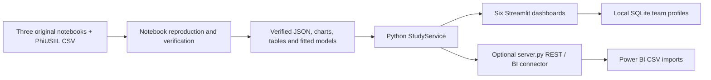

# Application structure

The 20 October amendment adds case_study/sampling.py for the common 10,000-host
sample and case_study/statistics.py for readable tiny tail probabilities and
verdicts. The analysis notebook calls the same functions and contains the actual
comparison plots. Preparation persists sampling.json, the 30-row comparison and
selected-host membership. Dashboards 1, 3, 4 and 6 consume these results.
The previous analysis notebook is retained in artifacts/reference_before_sampling.

The requested Streamlit frontend replaces the default React/Vite stack. Streamlit
also runs the application server, so a second web framework is not required for
the native website.

## Source priorities

- Department_Of_Phisheries.ipynb supplies preprocessing, exact question headings,
  hypotheses, calculations, test results and statistical decisions.
- Plots.ipynb supplies the EDA recipes, features, sampling, original figures and
  written interpretations. Its raw-record observation grain is retained.
- Model_Evaluation.ipynb supplies all four actually trained classifiers, their
  feature order, preprocessing, host split, parameters and evaluated predictions.

`case_study.prepare` executes the trusted fixed local analysis/model code in
isolated namespaces. `display` calls and stdout are captured. Figures are saved
to artifact folders, and original embedded notebook PNGs are preserved separately.
The known stale model references in the statistical export cell are adapted
explicitly; statistical calculation cells are not replaced.

Selected EDA plots are rendered interactively using the same source columns,
sampling seeds, cutoffs, histogram bins, transformations and statistical definitions.
Original figures and code remain visible in expandable source views.

## Verification and serving

Preparation compares every statistical output with the saved notebook statistic
at its four-decimal precision and exact p-value display. The reproduced model
comparison, including confusion counts, must match the saved notebook table.
Discrepancies stop preparation instead of publishing replacement scores.

The manifest fingerprints the dataset, all notebooks and generated files.
`StudyService` rejects stale sources or inconsistent core artifacts, and checks
the scikit-learn version before loading local joblib artifacts. Serialized models
come only from local preparation; the website does not accept uploaded models
or executable notebooks.

Inference follows the source feature order. Naive Bayes and logistic regression
use log1p counts and training-only count means/standard deviations; binary flags
remain unchanged. Both trees use the original numeric inputs. Random Fill selects
one actual held-out row, preserving its joint feature values.

Team profiles are four parameterized SQLite records. Uploaded PNG/JPEG files
are validated, limited in size/resolution and re-encoded before persistence.
The default database is local and excluded from Git and the release archive.

The optional API binds only to 127.0.0.1. It serves an explicit table whitelist;
request paths cannot become arbitrary filesystem paths. Streamlit calls the
same Python service directly, so server.py is required only for external API/BI
access. There are exactly six primary dashboards.
